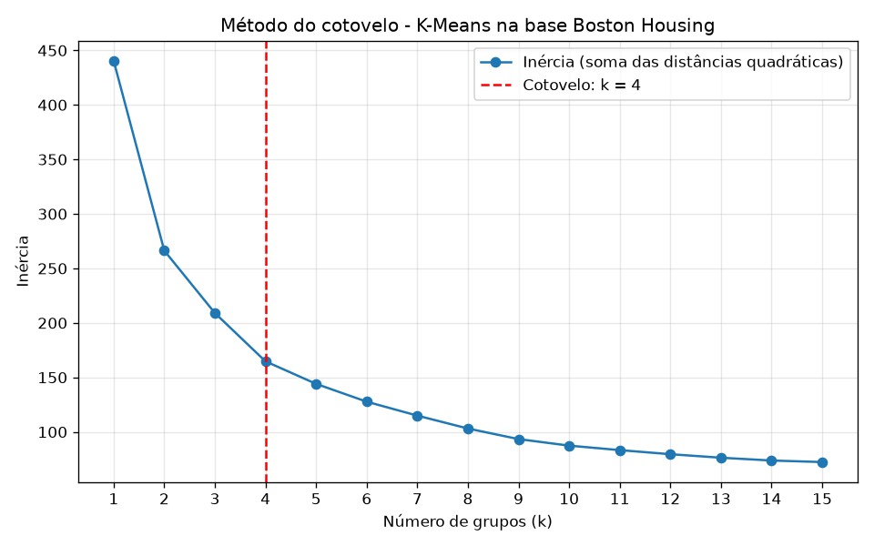

# Clusterização K-Means – Boston Housing

Avaliação do 2º bimestre – Data Science

Clusterização (aprendizado não supervisionado) da base **Boston Housing** com o algoritmo
**K-Means**, dividida em dois módulos:

| Módulo | Arquivo | O que faz |
|---|---|---|
| Treinamento | `treinamento.py` | normaliza a base, encontra o número ótimo de grupos pelo método do cotovelo, treina e salva o modelo |
| Inferência | `inferencia.py` | recebe uma nova residência, normaliza, infere o grupo e exibe o centroide desnormalizado |

## Estrutura do repositório

```
├── dados/
│   └── HousingData.csv            # base Boston Housing (506 residências x 14 atributos)
├── treinamento.py                 # módulo de treinamento
├── inferencia.py                  # módulo de inferência
├── modelos/                       # gerados pelo treinamento
│   ├── imputador_num.model        # imputador de ausentes (mediana) dos atributos quantitativos
│   ├── imputador_cat.model        # imputador de ausentes (moda) dos atributos categóricos
│   ├── normalizador_boston.model  # MinMaxScaler treinado com os atributos quantitativos
│   ├── estrutura_colunas.model    # ordem das colunas usada no treinamento
│   └── kmeans_boston.model        # modelo K-Means treinado
├── resultados/                    # gerados pelo treinamento
│   ├── metodo_cotovelo.png        # gráfico do método do cotovelo
│   ├── metodo_cotovelo.csv        # inércia obtida para cada k
│   ├── centroides.csv             # centroides de cada grupo (desnormalizados)
│   └── base_com_grupos.csv        # base original com o grupo atribuído a cada residência
├── requirements.txt
└── README.md
```

## Como executar

```bash
pip install -r requirements.txt

# 1) módulo de treinamento: gera as pastas modelos/ e resultados/
python treinamento.py

# 2) módulo de inferência: classifica a residência de exemplo definida no código
python inferencia.py

# 2b) ou informe os dados da nova residência pelo terminal
python inferencia.py --interativo
```

Testado com Python 3.13, pandas 2.3, scikit-learn 1.9 e matplotlib 3.11.

## A base de dados

Cada linha da base descreve uma região residencial de Boston (506 linhas, 14 atributos).

| Atributo | Descrição | Tipo |
|---|---|---|
| CRIM | taxa de criminalidade per capita | quantitativo |
| ZN | % de terrenos residenciais com lotes acima de 25.000 pés² | quantitativo |
| INDUS | % de área ocupada por negócios não varejistas | quantitativo |
| **CHAS** | faz limite com o rio Charles (1 = sim, 0 = não) | **categórico** |
| NOX | concentração de óxido nítrico (partes por 10 milhões) | quantitativo |
| RM | número médio de cômodos por residência | quantitativo |
| AGE | % de unidades construídas antes de 1940 | quantitativo |
| DIS | distância ponderada até 5 centros de emprego de Boston | quantitativo |
| RAD | índice de acesso a rodovias radiais | quantitativo (ordinal) |
| TAX | imposto sobre a propriedade (por US$ 10.000) | quantitativo |
| PTRATIO | proporção aluno/professor | quantitativo |
| B | 1000(Bk − 0,63)², sendo Bk a proporção de população negra | quantitativo |
| LSTAT | % da população de baixa renda | quantitativo |
| MEDV | valor mediano das residências (em US$ 1.000) | quantitativo |

A versão da base usada contém **valores ausentes (NA)**: 20 em cada uma das colunas
CRIM, ZN, INDUS, CHAS, AGE e LSTAT.

## Módulo de treinamento (`treinamento.py`)

### 1. Separação entre dados categóricos e quantitativos

- **CHAS** é o único atributo categórico (binário). Mesmo sendo representado por 0 e 1,
  ele não é uma medida: não faz sentido calcular "meio rio Charles". Por isso é tratado
  separadamente dos quantitativos.
- Os demais 13 atributos são quantitativos. **RAD** é um índice ordinal (quanto maior,
  mais acesso a rodovias), então é mantido como quantitativo.

### 2. Tratamento dos valores ausentes

O K-Means não aceita NA. Cada coluna quantitativa recebe a sua **mediana** e a coluna
categórica recebe a sua **moda** (`SimpleImputer`). Os dois imputadores são salvos em
`modelos/`, para que uma nova residência com algum dado desconhecido receba o mesmo
tratamento na inferência.

### 3. Normalização

- **Quantitativos:** `MinMaxScaler`, que leva cada coluna para a escala de 0 a 1. Sem isso,
  atributos com valores grandes (TAX chega a 711) dominariam o cálculo das distâncias
  frente a atributos pequenos (NOX fica entre 0,38 e 0,87). O normalizador é treinado
  (`fit`) e salvo em `modelos/normalizador_boston.model`.
- **Categóricos:** *one-hot encoding* com `pd.get_dummies`. CHAS vira duas colunas
  (`CHAS_0` e `CHAS_1`) com valores 0/1, ou seja, já na mesma escala dos quantitativos
  normalizados. Não se aplica MinMaxScaler em categoria, pois os códigos não têm ordem
  nem distância entre si.
- A base normalizada é a junção das duas partes (15 colunas). A ordem das colunas é salva
  em `modelos/estrutura_colunas.model` para a inferência montar a nova residência igual.

Não há necessidade de balancear a base: a clusterização é não supervisionada, não existe
uma classe-alvo para balancear.

### 4. Número ótimo de grupos – método do cotovelo (distâncias)

Para cada k de 1 a 15 treina-se um K-Means e mede-se a **inércia**: a soma das distâncias
quadráticas de cada residência ao centroide do seu grupo. A inércia sempre cai quando k
aumenta; o cotovelo é o ponto a partir do qual aumentar k deixa de trazer ganho relevante.

O cotovelo é localizado automaticamente: é o ponto da curva mais distante da reta que liga
o primeiro ao último ponto (com os eixos normalizados para 0..1).

| k | Inércia | | k | Inércia |
|---|---|---|---|---|
| 1 | 440.44 | | 9 | 93.42 |
| 2 | 266.33 | | 10 | 87.42 |
| 3 | 209.08 | | 11 | 83.31 |
| **4** | **164.74 ← cotovelo** | | 12 | 79.56 |
| 5 | 144.09 | | 13 | 76.33 |
| 6 | 127.73 | | 14 | 73.77 |
| 7 | 114.96 | | 15 | 72.36 |
| 8 | 103.13 | | | |



**Número ótimo de grupos: k = 4.**

### 5. Treinamento e salvamento do modelo

`KMeans(n_clusters=4, n_init=10, random_state=42)` é treinado com a base normalizada e
salvo em `modelos/kmeans_boston.model` (pickle). O `random_state` fixo garante que o
resultado seja reproduzível.

### Grupos encontrados

Centroides de cada grupo já desnormalizados (escala original dos dados):

| Grupo | Residências | CRIM | ZN | INDUS | CHAS | NOX | RM | AGE | DIS | RAD | TAX | PTRATIO | B | LSTAT | MEDV |
|---|---|---|---|---|---|---|---|---|---|---|---|---|---|---|---|
| 0 | 171 | 0.11 | 28.49 | 5.12 | 0 | 0.445 | 6.53 | 38.1 | 6.00 | 4.2 | 293 | 17.6 | 389.9 | 7.69 | 26.9 |
| 1 | 128 | 12.31 | 0.00 | 18.07 | 0 | 0.668 | 5.97 | 89.4 | 2.07 | 23.4 | 667 | 20.2 | 285.1 | 18.93 | 15.3 |
| 2 | 173 | 0.63 | 1.78 | 11.39 | 0 | 0.573 | 6.23 | 82.5 | 3.03 | 4.6 | 335 | 18.2 | 373.4 | 13.19 | 22.3 |
| 3 | 34 | 1.71 | 7.94 | 12.39 | 1 | 0.585 | 6.56 | 76.5 | 3.07 | 9.4 | 386 | 17.6 | 373.9 | 11.43 | 28.8 |

- **Grupo 0 – subúrbios residenciais:** criminalidade quase nula, muitos lotes grandes (ZN),
  casas mais novas (AGE baixo), longe dos centros de emprego (DIS alto), pouca população de
  baixa renda e valor alto (MEDV ≈ 26,9).
- **Grupo 1 – área urbana densa e industrial:** maior criminalidade, INDUS e NOX altos, casas
  antigas, perto dos centros, RAD 24 e TAX 666 (zona de maior tributação), LSTAT alto e o
  menor valor (MEDV ≈ 15,3).
- **Grupo 2 – perfil intermediário:** criminalidade baixa, casas antigas, valores medianos
  (MEDV ≈ 22,3).
- **Grupo 3 – margem do rio Charles:** reúne exatamente as 34 residências com CHAS = 1 e tem
  o maior valor mediano (MEDV ≈ 28,8). O atributo categórico pesa bastante na distância
  porque as suas colunas *one-hot* ficam sempre nos extremos da escala (0 ou 1).

## Módulo de inferência (`inferencia.py`)

1. **Receber os dados da nova residência.** Um dicionário com os 14 atributos definido no
   código (residência de exemplo) ou, com `--interativo`, os valores digitados no terminal.
   Um atributo desconhecido pode ficar em branco (`None`): ele recebe a mediana/moda
   aprendida no treinamento.
2. **Normalizar os dados da nova residência.** Usa-se exatamente o que foi salvo no
   treinamento, sempre com `transform()` (nunca `fit`): imputadores, `MinMaxScaler` nos
   quantitativos e `get_dummies` + `reindex` nos categóricos, para gerar as mesmas colunas
   `CHAS_0`/`CHAS_1` na mesma ordem.
3. **Inferir o grupo.** `kmeans.predict()` devolve o grupo do centroide mais próximo; o
   programa também mostra a distância a cada centroide.
4. **Exibir o centroide desnormalizado.** A parte quantitativa do centroide volta à escala
   original com `inverse_transform()` do `MinMaxScaler`. Na parte categórica, cada coluna
   *one-hot* do centroide guarda a proporção da categoria dentro do grupo (ex.: `CHAS_0 = 0,93`
   e `CHAS_1 = 0,07`); a categoria do centroide é a de maior proporção, que é remontada com
   `pd.from_dummies`.

Saída da residência de exemplo (resumida):

```
=== NOVA RESIDÊNCIA (dados normalizados) ===
  CRIM  ZN  INDUS    NOX     RM    AGE   DIS    RAD    TAX  PTRATIO      B  LSTAT   MEDV  CHAS_0  CHAS_1
0.0011 0.2 0.2031 0.1337 0.5631 0.3821 0.352 0.1304 0.2156   0.4681 0.9826  0.173 0.4667       1       0

=== GRUPO INFERIDO: 0 ===
Distância da nova residência a cada centroide (escala normalizada):
  grupo 0: 0.1479   <-- mais próximo
  grupo 1: 1.5264
  grupo 2: 0.6425
  grupo 3: 1.5558

=== CENTROIDE DO GRUPO 0 (dados desnormalizados) ===
  CRIM     =      0.109   taxa de criminalidade per capita
  ZN       =     28.485   % de terrenos residenciais com lotes acima de 25.000 pés²
  INDUS    =      5.122   % de área ocupada por negócios não varejistas
  CHAS     =          0   faz limite com o rio Charles (1 = sim, 0 = não)
  NOX      =      0.445   concentração de óxido nítrico (partes por 10 milhões)
  RM       =      6.525   número médio de cômodos por residência
  AGE      =     38.085   % de unidades construídas antes de 1940
  DIS      =      6.003   distância ponderada até 5 centros de emprego de Boston
  RAD      =      4.240   índice de acesso a rodovias radiais
  TAX      =    293.170   imposto sobre a propriedade (por US$ 10.000)
  PTRATIO  =     17.600   proporção aluno/professor
  B        =    389.901   1000(Bk - 0,63)², sendo Bk a proporção de população negra
  LSTAT    =      7.693   % da população de baixa renda
  MEDV     =     26.911   valor mediano das residências (em US$ 1.000)
```

## Tecnologias

Python 3.13 · pandas · numpy · scikit-learn (`MinMaxScaler`, `SimpleImputer`, `KMeans`) · matplotlib
